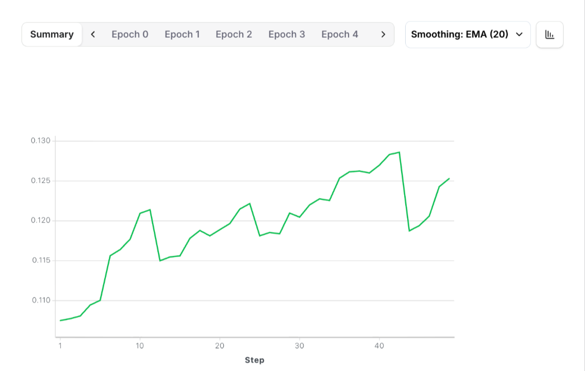
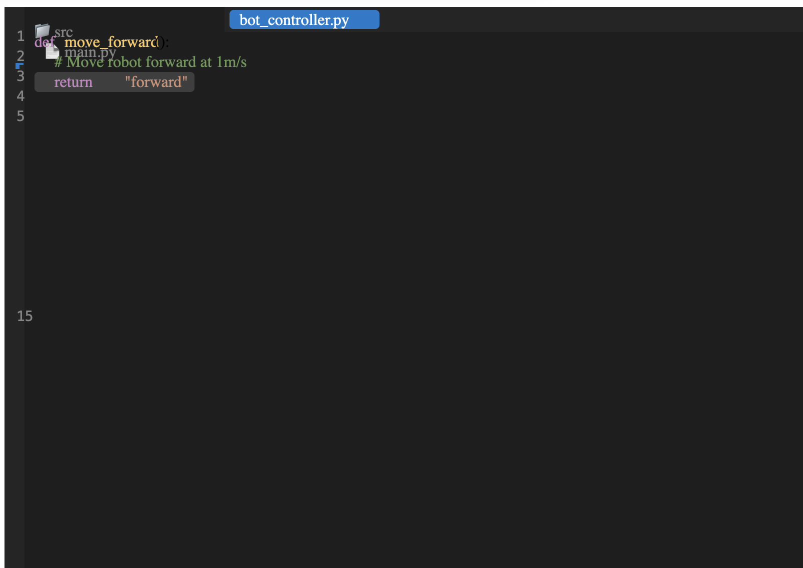
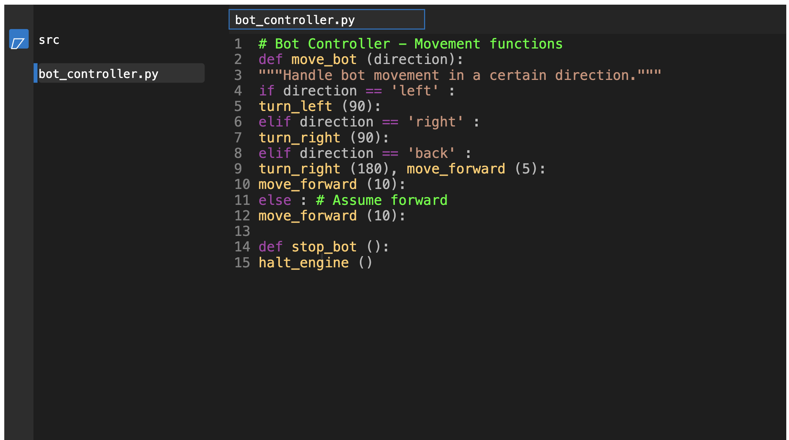

# SVG generation and evaluation with Eval Protocol

This repository preserves an SVG agent trained with Fireworks managed reinforcement fine-tuning. Fireworks has retired managed RFT and shut down the hosted tracing gateway that this example's remote rollout processor used. Starting the Vercel server locally still leaves the evaluator dependent on that gateway.

For a runnable local evaluation, see the [GSM8K quickstart](https://github.com/eval-protocol/quickstart-gsm8k). For new reinforcement learning jobs, use the [Fireworks Training API](https://docs.fireworks.ai/fine-tuning/training-api/introduction).

## How the example worked

- The [Vercel rollout server](vercel_svg_server_ts/api/init.ts) asked a model to generate SVG code for a prompt from [SVGBench](https://github.com/johnbean393/SVGBench).
- The [evaluator](evaluator/svgagent.py) used the remote rollout processor to retrieve the generated response. It [rendered the SVG](evaluator/utils.py) and asked GPT-4.1 to judge how many of the prompt's visual requirements the image met.

## Historical training results

  

### SVG Quality Improvement

These images show an example rollout from the first and eighth epochs of the original run.

**Before (1st Epoch):**

  

**After (8th Epoch):**

  

